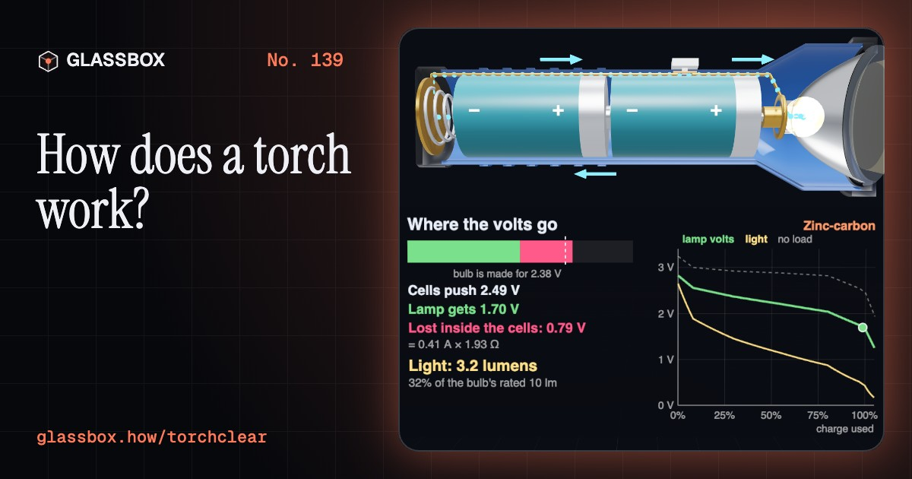
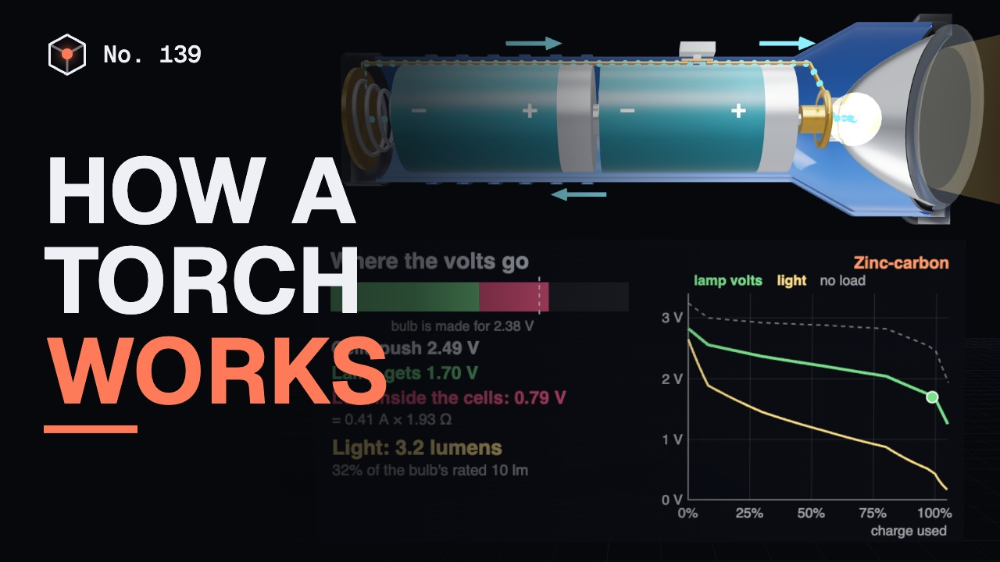
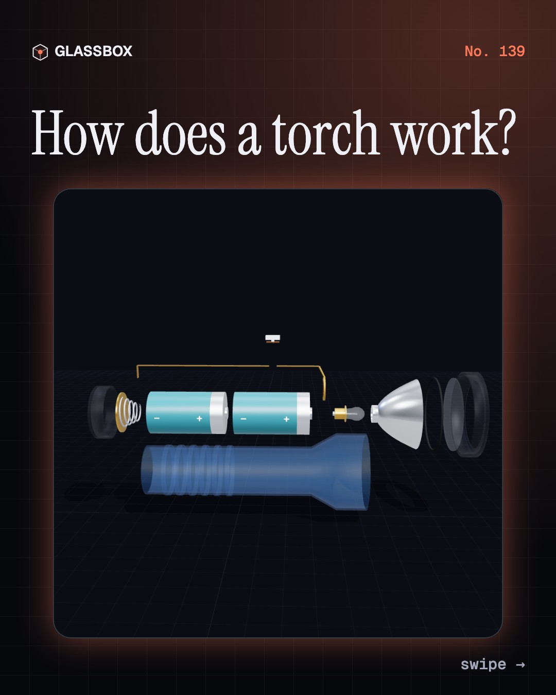
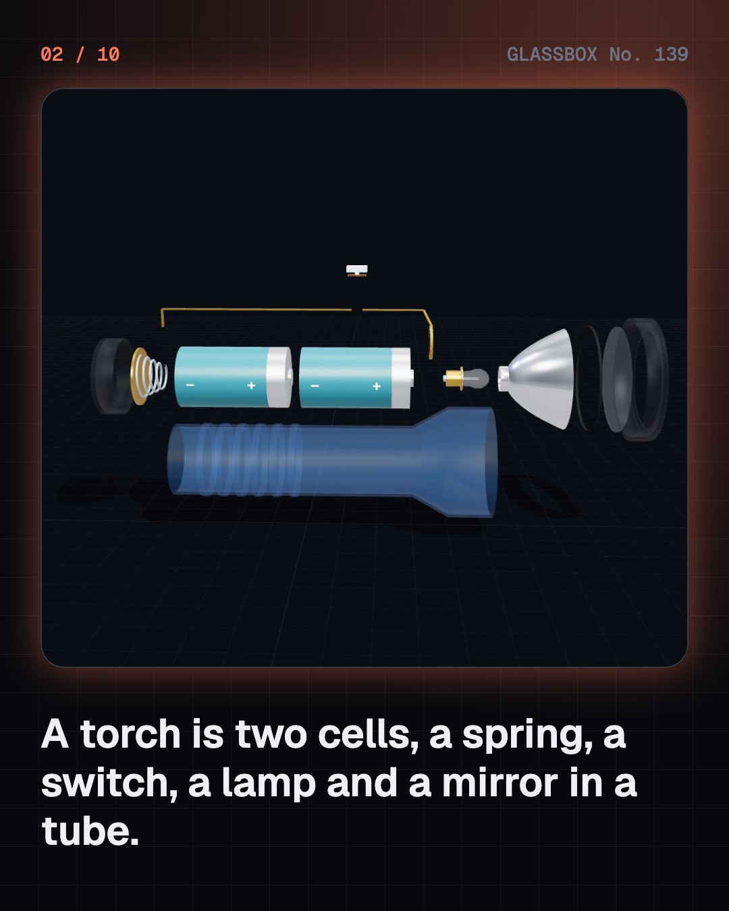
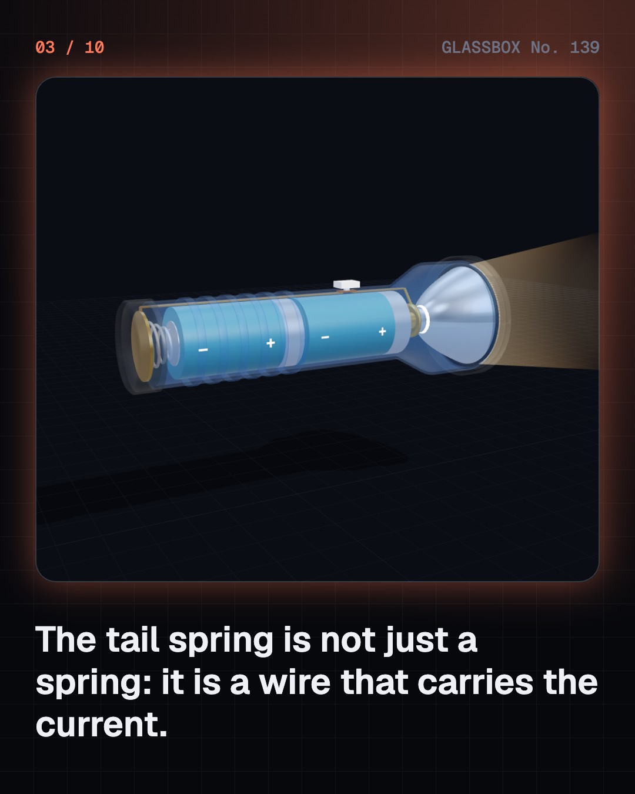
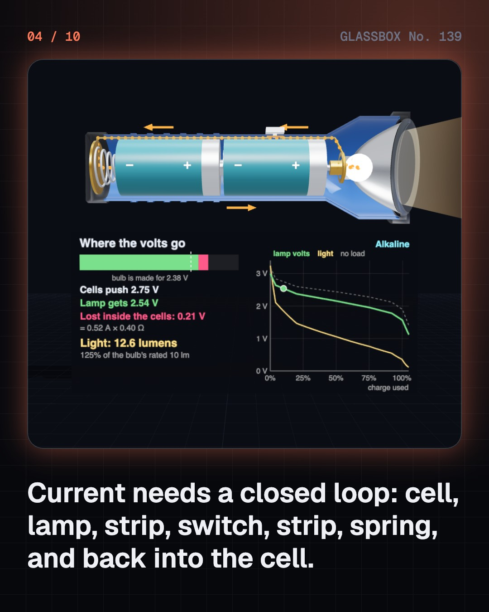

<!-- glassbox:start -->
<!-- Generated from glassbox.json by the Glassbox hub (npm run readme -- torchclear). Edit glassbox.json, not this block. -->
<p align="center"><a href="https://glassbox.how/e/torchclear/"></a></p>

<h1 align="center">TorchClear</h1>

<p align="center"><b>How does a torch work?</b><br>Two cells, a spring, a switch and a mirror shaped like a parabola. Take a torch apart in 3D, follow the current round its loop, and trace the rays that turn a tiny lamp into a beam.</p>

<p align="center"><a href="https://glassbox.how/torchclear/"><b>▶ Play with it</b></a> &nbsp;·&nbsp; <a href="https://glassbox.how/e/torchclear/">Read the 60-second explainer</a> &nbsp;·&nbsp; <a href="https://glassbox.how/torchclear/glassbox/reel.mp4">Watch the 40-second video</a></p>

<p align="center">
  <a href="https://glassbox.how/e/torchclear/"></a>
  <a href="https://glassbox.how/e/torchclear/"></a>
  <a href="LICENSE"></a>
  <a href="LICENSE-CONTENT.md"></a>
  <a href="#privacy"></a>
</p>

## In 60 seconds

1. **Ten parts in a tube.** A torch is two cells, a spring, two metal strips, a switch, a lamp, a reflector, a lens and a case. The spring in the tail pushes everything into contact, and it is also a wire that carries the current.
2. **One closed loop.** Current flows only round a complete circuit: out of the cell's + cap, through the lamp, along a strip to the switch, along another strip to the spring and back into the − end. Electrons really travel the other way round. As cells run down they push less and waste more inside, so a bulb fades to orange.
3. **A hot wire against a glowing chip.** A filament bulb makes light by being white-hot, at about 2,450 K, and wastes nearly all its energy as heat: about 8 lumens per watt. A white LED is a blue chip under a yellow phosphor. It gives 100 to 200 lumens per watt, but needs a driver to hold its current steady.
4. **A parabola makes the beam.** The reflector is a parabola. Every ray that leaves its focus bounces off parallel to the axis, so a lamp at the focus gives a tight hotspot. Rays that miss the mirror make the dim spill around it. Move the lamp a millimetre or two and the beam spreads: that is the focus ring.
5. **What is inside the cells.** In a zinc-carbon cell the can itself is the fuel, which is why flat ones leak. An alkaline cell is built inside out and lasts about three times as long at torch currents. NiMH and lithium-ion cells are rolled-up foils that can be recharged. Run time is roughly capacity divided by current.
6. **Torches with no shop-bought cells.** A shake torch slides a magnet through a coil: the changing field makes a voltage, a capacitor stores the charge and an LED uses it. An emergency light keeps a battery charged from the mains and switches itself on in a power cut.

## Words worth knowing

| Term | Meaning |
|---|---|
| **Circuit** | A complete loop that current can flow round, from one end of a cell, through the lamp, and back to the other end. |
| **Conventional current** | The direction current is drawn on diagrams, from + to −. The electrons in the wire actually move from − to +. |
| **Internal resistance** | The resistance inside a cell. It takes a share of the cell's voltage whenever current flows, and it grows as the cell runs down. |
| **Lumen** | The unit for all the visible light a lamp gives out. A classic torch bulb gives about 10; a one-watt white LED about 140. |
| **Candela and lux** | Candela measure how concentrated a beam is in one direction. Lux measure the light landing on a surface: candela divided by distance squared. |
| **Parabola and focus** | The curve of the reflector, and the point inside it where the lamp must sit for the reflected rays to leave parallel. |
| **Hotspot and spill** | The bright centre of a beam made by the reflector, and the dim wide ring made by light that missed it. |
| **Capacity** | How much charge a cell can deliver, in amp-hours. Run time is roughly capacity divided by current. |
| **Induction** | Making a voltage in a coil by changing the magnetic field through it, as a shake torch does. |

## A short history

**From a pile of metal discs in 1800 to a white LED the size of a grain of rice: how light got into your hand.**

- **1800** · The first battery (Alessandro Volta, Como and Pavia, Italy)
- **1886** · The dry cell: a battery you can carry (Carl Gassner, Mainz, Germany)
- **1899** · The tubular torch is patented (David Misell, for Conrad Hubert’s company, New York, USA)
- **1899** · Why it was called a "flash" light (Conrad Hubert, New York, USA)
- **1904** · The tungsten filament (Sándor Just and Franjo Hanaman, Budapest, Hungary)
- **1922** · Ten million torch users (American buyers, USA)
- **1958** · A torch factory in Lucknow (Union Carbide India (Eveready), Lucknow, India)
- **1959** · The alkaline cell (Lewis Urry, Karl Kordesch and Paul Marsal, Parma, Ohio, USA)

The full story, with 33 moments, charts, people and 38 sources: [glassbox.how/e/torchclear/history](https://glassbox.how/e/torchclear/history/). The data lives in [`history.json`](history.json).

## Video and slides

Made with the Glassbox studio from this box's storyboard (`window.glassbox.director`). Free to reuse under CC BY 4.0.

<a href="https://glassbox.how/torchclear/glassbox/video.mp4"></a>

<p><a href="glassbox/slide-1.jpg"></a> <a href="glassbox/slide-2.jpg"></a> <a href="glassbox/slide-3.jpg"></a> <a href="glassbox/slide-4.jpg"></a></p>

| File | What | Size |
|---|---|---|
| [`glassbox/reel.mp4`](https://glassbox.how/torchclear/glassbox/reel.mp4) | Reel / Short, with captions and soundtrack | 1080×1920 |
| [`glassbox/video.mp4`](https://glassbox.how/torchclear/glassbox/video.mp4) | YouTube video, with captions and soundtrack | 1920×1080 |
| `glassbox/slide-1…10.jpg` | Instagram carousel | 1080×1350 |
| `glassbox/thumb.jpg` | YouTube thumbnail | 1280×720 |
| `glassbox/cover.jpg` | Share card and repo social preview | 1200×630 |
| [`glassbox/history-reel.mp4`](https://glassbox.how/torchclear/glassbox/history-reel.mp4) | “History in 10 moments” Reel / Short | 1080×1920 |
| `glassbox/history-slide-*.jpg` | History carousel | 1080×1350 |
| `glassbox/post.json` | Post copy and schedule used by the publish kit | |

## Privacy

This box has no accounts and no ads, and it ships its own fonts and libraries. When you run it yourself it sends nothing anywhere. On glassbox.how, the site's `/bar.js` also loads Glassbox's analytics: **Google Analytics** to count visits (it asks first in the EU, UK and Switzerland, and stays off when your browser sends Global Privacy Control or Do Not Track) and **ClickTrust** to detect bots.

It remembers a few things **in your own browser only**, and never sends them anywhere:

| Browser storage key | What it holds |
|---|---|
| `torchclear.v1` | Which chapters you have opened, your best quiz scores, and sound on or off. |

Exactly what each one sees is at [glassbox.how/privacy](https://glassbox.how/privacy/).

## Licences

- **Code:** [MIT](LICENSE). Use it, change it, ship it.
- **Explanations, text, images and videos** (`glassbox.json`, `glassbox/`): [CC BY 4.0](LICENSE-CONTENT.md). Credit “Glassbox, glassbox.how/e/torchclear”.
- **Third-party parts** keep their own licences: [three.js](https://threejs.org) (MIT), [Geist, Instrument Serif](https://openfontlicense.org) (SIL OFL 1.1).
- The Glassbox name and logo aren't covered by either licence. See the [terms](https://glassbox.how/terms/).

Found a mistake? [Open an issue](https://github.com/bdeeps/torchclear/issues). Corrections happen in public.
<!-- glassbox:end -->

## Run it

It's plain HTML, CSS and JavaScript. No build step and no dependencies. Run locally, it contacts no other website.

```bash
python3 -m http.server 8000
```

Three.js and the fonts ship in `vendor/` and `fonts/`, so it also works offline.

Then open http://localhost:8000.

## How it's built

| File | What |
|---|---|
| `index.html`, `css/app.css` | The page and its styles |
| `js/app.js`, `js/stage.js`, `js/ui.js`, `js/kit.js` | The shared Glassbox 3D engine: chapters, 3D stage, controls, quiz, video director |
| `js/chapters/*.js` | One file per chapter: the 3D model, controls, text, key terms, quiz and video scenes |
| `js/torch.js` | TorchClear's shared parts: the bulb, LED, cell and circuit sums, the parabola ray tracer, the 3D torch and the chart helpers |
| `glassbox.json` | Title, question, explainer beats, key terms, browser storage and credits shown on glassbox.how |
| `reel` in each chapter | The storyboard the Glassbox studio records into short videos |
| `glassbox/` | The published video, slides, thumbnail and post copy |
| `fonts/`, `vendor/three/` | Self-hosted Geist and Instrument Serif (SIL OFL 1.1) and three.js (MIT) |
